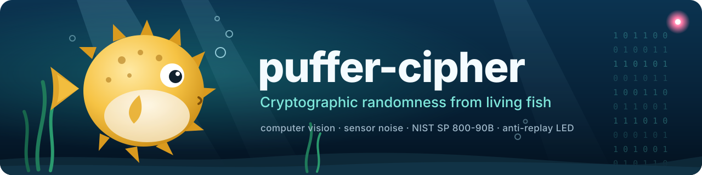
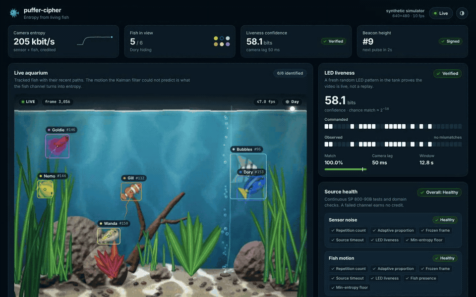
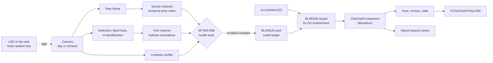
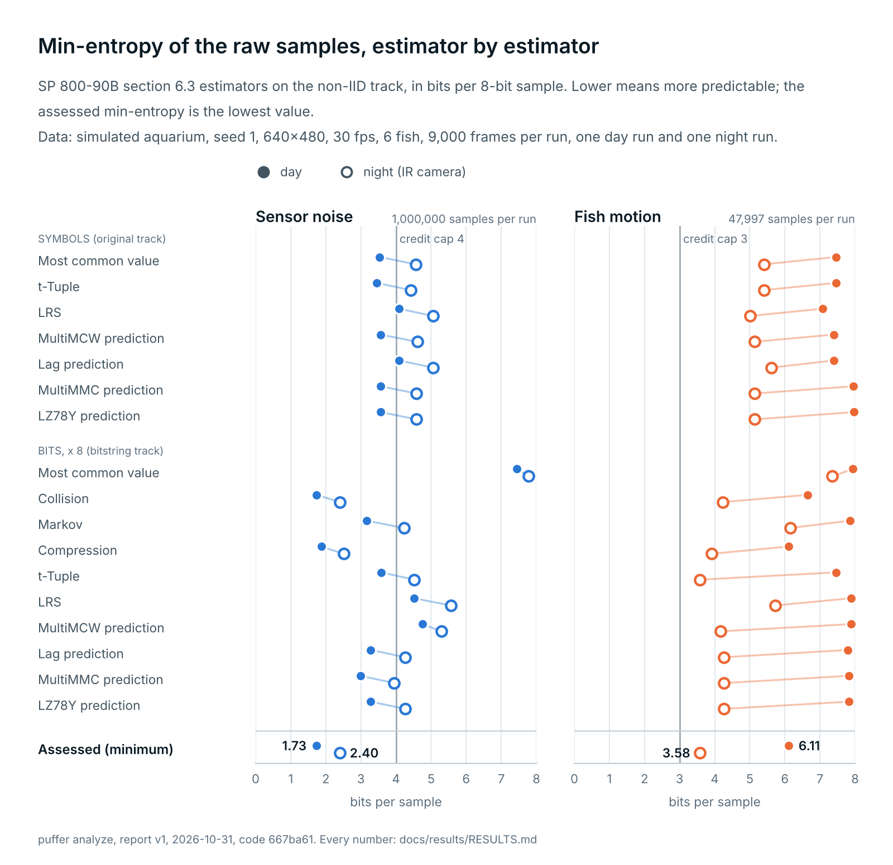
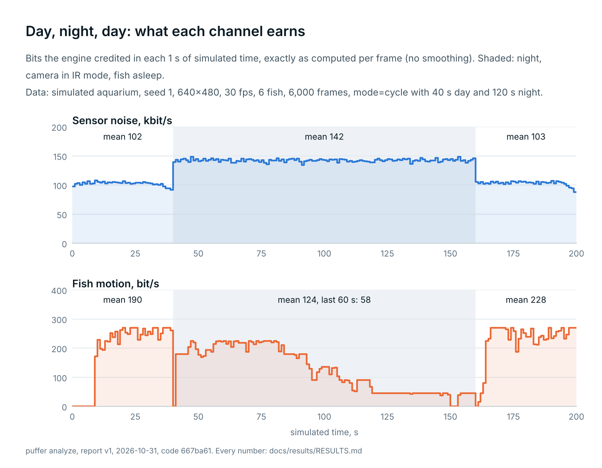
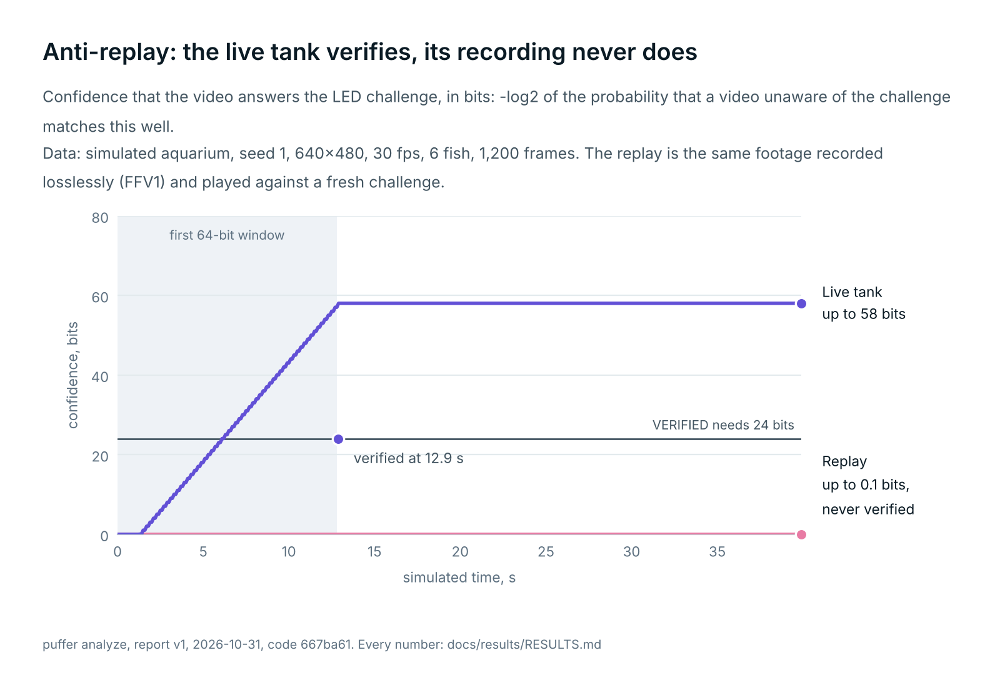
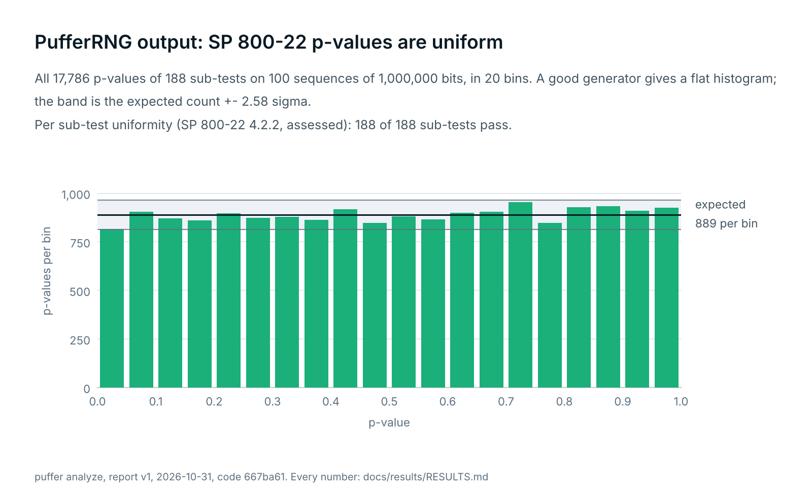
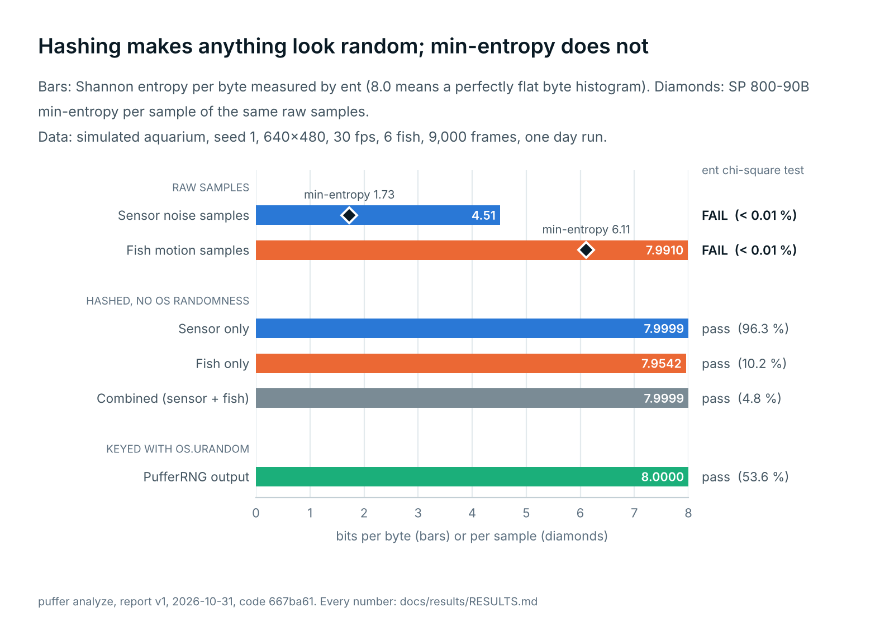
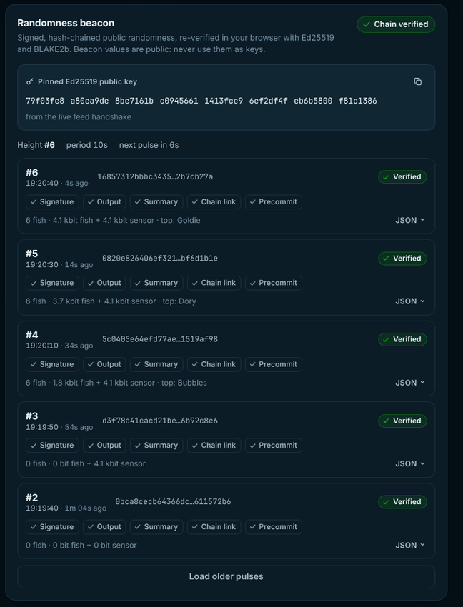

<p align="center">
  
</p>

<p align="center">
  <a href="https://github.com/lukamaga/puffer-cipher/actions/workflows/ci.yml"></a>
  
  
  
  <a href="https://github.com/astral-sh/ruff"></a>
  <a href="LICENSE"></a>
</p>

<p align="center">
  
  
  
  
  
  
  
  
  
  
</p>

<p align="center">
  <b>Cryptographic keys seeded by an aquarium.</b><br>
  A camera films the tank, computer vision measures how unpredictably every fish moves,<br>
  an LED proves the video is live, and libsodium turns the result into keys and ciphertext.
</p>

<p align="center">
  <a href="#quick-start">Quick start</a> ·
  <a href="#how-it-works">How it works</a> ·
  <a href="#the-led-liveness-check">Liveness check</a> ·
  <a href="#results">Results</a> ·
  <a href="#compared-with-lavarand">vs LavaRand</a> ·
  <a href="#threat-model">Threat model</a> ·
  <a href="docs/DESIGN.md">Design</a>
</p>

<p align="center">
  
</p>

## Overview

puffer-cipher turns a fish tank into a source of cryptographic entropy. Every
camera frame feeds two channels. The **sensor channel** harvests temporal pixel
noise, reflections and bubbles. The **fish channel** tracks each fish with
ByteTrack and keeps only the part of its motion that a Kalman filter failed to
predict. Both channels are measured with NIST SP 800-90B estimators, guarded by
continuous health tests, hashed into a BLAKE2b pool and mixed with
`os.urandom`. libsodium then expands the seed with ChaCha20 and encrypts with
XChaCha20-Poly1305.

The project follows the idea of Cloudflare's LavaRand and adds three things a
wall of lava lamps does not have: a challenge-response LED that proves the
video is live, entropy accounting per channel and per fish, and a public
randomness beacon that anyone can verify in a browser.

> [!NOTE]
> The animation above, the screenshots and every number in this README come
> from the built-in aquarium simulator. The code paths for a Raspberry Pi
> camera and a GPIO-driven LED are part of the project and described in
> [docs/hardware.md](docs/hardware.md).

## Highlights

| | |
|---|---|
| **Two measured entropy channels** | Sensor noise from every frame and the Kalman innovations of tracked fish. Credit comes from rolling SP 800-90B estimates, never from assumptions. |
| **Never weaker than the OS** | Every secret is `BLAKE2b(key = os.urandom(32), data = pool)` expanded by libsodium. A hostile camera feed cannot weaken the output. |
| **Proof of a live video** | The server blinks an LED in the tank with fresh random bits. A replayed recording cannot show them and loses all credit within one window. |
| **Health tests with teeth** | Repetition count and adaptive proportion tests per channel, plus frozen-frame, fish-presence, timeout and liveness gates. A failing channel earns zero credit until it recovers. |
| **Fish attribution** | Each key ships with a receipt that lists how many bits every fish contributed, and the dashboard keeps a weekly leaderboard of the most chaotic fish. |
| **Public randomness beacon** | Every 60 seconds an Ed25519-signed, hash-chained pulse with a precommitment to the next value. The dashboard re-verifies each pulse in the browser. |
| **Three interfaces** | A `puffer` command line, a FastAPI REST and WebSocket API, and a React dashboard. |
| **Library-grade cryptography only** | libsodium through PyNaCl and BLAKE2b from the Python standard library. The project designs formats and protocols, never primitives. |

## How it works



1. **Capture.** Frames come from a camera, a video file or the simulator. A
   day/night switch moves the camera to infrared when the tank lights go off.
2. **Extract.** The sensor channel samples 4,096 fixed pixel sites per frame and
   records their frame-to-frame differences. The fish channel quantises each
   tracked fish's Kalman innovation to 1/8 of a pixel. The LED region is masked
   out of both, because the blink pattern is the server's own challenge and
   carries no entropy.
3. **Test.** Each channel runs the SP 800-90B repetition count and adaptive
   proportion tests and a rolling estimate `min(MCV, Lag, MultiMMC)`. The
   predictors catch periodic or replayed data that symbol frequencies alone
   would overrate.
4. **Credit.** `credit = samples x min(H, cap) x 0.5`, and zero while a channel
   is starting up, degraded below threshold or failed.
5. **Mix.** A draw hashes the pool and keys the result with 32 fresh bytes from
   `os.urandom`. The pool ratchets after every draw, so later state cannot
   recompute earlier output.
6. **Use.** libsodium expands the seed into keys and nonces. Files are sealed
   with a chunked `secretstream` format that detects tampering, reordering and
   truncation. Public values such as nonces and salts use a separate path that
   consumes no camera credit.

The byte-level specification of every format lives in
[docs/DESIGN.md](docs/DESIGN.md).

## Quick start

```bash
git clone https://github.com/lukamaga/puffer-cipher.git
cd puffer-cipher
python -m venv .venv && source .venv/bin/activate
pip install -e .
```

Make a key from the aquarium, then encrypt and decrypt with it:

```bash
puffer keygen -o fish.key
puffer encrypt report.pdf -k fish.key          # writes report.pdf.puf
puffer decrypt report.pdf.puf -k fish.key      # writes report.pdf
puffer encrypt notes.txt --password            # Argon2id instead of a key file
```

`keygen` waits until the LED check passes and the fish have earned credit, then
prints where the entropy came from:

```text
Where the entropy of key 3035377944284ed9 came from
┏━━━━━━━━━━━━━━━━━━━━━━━━━━━━━━━━━━━┳━━━━━━━━━┳━━━━━━━━━━━━━━━━━━┳━━━━━━━┓
┃ contributor                       ┃    bits ┃                  ┃ share ┃
┡━━━━━━━━━━━━━━━━━━━━━━━━━━━━━━━━━━━╇━━━━━━━━━╇━━━━━━━━━━━━━━━━━━╇━━━━━━━┩
│ fish - share of the fish channel  │         │                  │       │
│ ● Nemo f1                         │     6.0 │ ██▊············· │ 17.4% │
│ ● Dory f2                         │     6.0 │ ██▊············· │ 17.4% │
│ ● Bubbles f3                      │     6.0 │ ██▊············· │ 17.4% │
│ ● Wanda f5                        │     6.0 │ ██▊············· │ 17.4% │
│ ● Goldie f6                       │     6.0 │ ██▊············· │ 17.4% │
│ ● Gill f4                         │     4.5 │ ██·············· │ 13.0% │
├───────────────────────────────────┼─────────┼──────────────────┼───────┤
│ channels - share of camera credit │         │                  │       │
│ fish                              │    34.5 │ ▏··············· │  0.8% │
│ camera sensor                     │ 4,096.0 │ ███████████████▊ │ 99.2% │
├───────────────────────────────────┼─────────┼──────────────────┼───────┤
│ os.urandom                        │   256.0 │ always mixed in  │     - │
└───────────────────────────────────┴─────────┴──────────────────┴───────┘
liveness ● verified (58.1 confidence bits) · light day · frames 536-736 · health sensor ok, fish ok
```

Run the engine, the beacon, the API and the dashboard on
`http://127.0.0.1:8000`:

```bash
(cd dashboard && npm ci && npm run build)
puffer serve
```

Or with Docker:

```bash
docker compose up --build                            # simulated aquarium
docker compose --profile pi up --build puffer-pi     # Raspberry Pi camera and GPIO LED
```

<details>
<summary><b>All commands</b></summary>

| command | what it does |
|---|---|
| `puffer keygen` | collect camera entropy and write a key file with its receipt |
| `puffer encrypt FILE` | seal a file; without `-k` or `--password` it creates a fresh fish key next to the output |
| `puffer decrypt FILE.puf` | verify and decrypt; plaintext is written only after the final tag checks out |
| `puffer random -n 32` | random bytes as hex or base64; `--stream` feeds `dieharder -g 200` |
| `puffer simulate -o tank.mp4` | render the aquarium simulator to a video |
| `puffer serve` | engine, beacon, REST and WebSocket API, dashboard |
| `puffer beacon verify FILE_OR_URL` | verify a beacon chain offline against a pinned key |
| `puffer analyze` | rebuild the statistics report in `docs/results` |
| `puffer fish` | leaderboard of the most chaotic fish |
| `puffer info` | versions, configuration and data directory |

Every option can also be set in a `puffer.toml` file or through `PUFFER_*`
environment variables, for example `PUFFER_SOURCE=camera:0`.

</details>

## The LED liveness check

A camera-based entropy source has an obvious weakness: if someone replaces the
video with a recording, the "random" frames become known in advance. Hashing
cannot fix that, because a hash of predictable data is predictable.

puffer-cipher closes the gap with a challenge only a live camera can answer.
The server draws fresh random bits from `os.urandom` and blinks an LED inside
the field of view with a Manchester code, one bit every 200 ms. The verifier
finds the LED in the image by correlating every region with the commanded
pattern, estimates the camera latency, decodes the observed bits and compares
them with the challenge over a sliding window of 64 bits.

- **Verified** requires a match of at least 90% and at least 24 bits of
  confidence, where confidence is `-log2` of the probability that a random
  video matches this well, corrected for the number of latency guesses.
- **A live tank** reaches 58 confidence bits, recovers the simulated camera lag
  of 50 ms exactly, and verifies within 13 seconds of start-up.
- **A replayed recording** sees an old pattern, matches about half the bits by
  chance and never verifies. In 60 replay trials there were zero false
  accepts. While liveness fails, both camera channels earn zero credit and
  every output falls back to the OS generator alone.

Liveness proves freshness, not authenticity: an attacker who watches the LED in
real time and composites it into a forged video would pass. The threat model
below covers what that means.

## Results

Every number below comes from the simulated aquarium (seed 1, 640x480,
30 fps, 6 fish) and is reproducible with `puffer analyze`. The full report,
with every estimator, sequence and p-value, is in
[docs/results/RESULTS.md](docs/results/RESULTS.md).

### Where the entropy comes from

Each channel's raw samples were assessed with all ten estimators of NIST SP
800-90B section 6.3. The engine credits at most half of the assessed
min-entropy, and never more than 3 bits per fish sample.

<picture>
  <source media="(prefers-color-scheme: dark)" srcset="docs/media/min-entropy-dark.png">
  
</picture>

| | Sensor, day | Sensor, night | Fish, day | Fish, night |
|---|---:|---:|---:|---:|
| Min-entropy, SP 800-90B (bits per sample) | 1.73 | 2.40 | 6.11 | 3.58 |
| Samples assessed | 1,000,000 | 1,000,000 | 47,997 | 15,705 |
| Credited per sample (bits) | 0.85 | 1.16 | 1.50 | 1.50 |
| Credited rate | 104 kbit/s | 143 kbit/s | 242 bit/s | 77 bit/s |

The sensor estimate uses the full million samples the standard asks for. The
fish channel produces about five samples per frame, so its estimate rests on
fewer samples and should be read as indicative.

### Day and night

When the tank lights go off the camera switches to infrared. The fish sleep,
fewer of them stay tracked, and their credit falls from 190 bit/s by day to
58 bit/s late in the night. The sensor channel rises from 102 to 142 kbit/s
because the infrared mode runs at a higher gain. Credit always follows the
measurement, so the balance between channels adapts without configuration.

<picture>
  <source media="(prefers-color-scheme: dark)" srcset="docs/media/day-night-cycle-dark.png">
  
</picture>

### Live tank versus replay

The live run is recorded losslessly to an FFV1 file and fed back to a fresh
engine. The verifier is even told where the LED is, the most favourable setup
an attacker could ask for.

| run | LED challenge | verified after | best confidence | camera credit |
|---|---|---:|---:|---:|
| Live tank | A | 12.9 s | 58.1 bits | 2,304,492 bits |
| Replay of the live run | fresh, from `os.urandom` | never | 0.1 bits | 0 bits |
| Control: same replay | A | 12.9 s | 58.1 bits | 2,304,968 bits |

The control proves the replay fails because the challenge is fresh, not
because of the codec or the detector.

<picture>
  <source media="(prefers-color-scheme: dark)" srcset="docs/media/liveness-replay-dark.png">
  
</picture>

### Statistical test suites

| stream | OS randomness | NIST SP 800-22 | ent, bits per byte | ent chi-square |
|---|:---:|---|---:|:---:|
| Raw sensor samples | no | not applicable | 4.51 | fails |
| Sensor only, conditioned | no | 3 of 188 sub-tests outside the band, 2.2 expected | 7.9999 | passes |
| Sensor and fish, conditioned | no | 6 of 188 outside, 2.2 expected | 7.9999 | passes |
| PufferRNG output, 100 x 10<sup>6</sup> bits | yes | 5 of 188 outside, 3.6 expected | 8.0000 | passes |

**dieharder** ran every test of its `-a` battery on 50 GiB of PufferRNG output
streamed through a pipe, so no data was ever rewound: **83 passed, 5 weak,
0 failed** out of 88 results. A few weak results are expected from a perfect
generator at this count.

These suites are a sanity check, not a measurement of entropy. A hash of a
simple counter would pass them too. That is why the raw samples are shown
failing `ent`, and why credit comes only from the SP 800-90B min-entropy of the
raw samples.

<details>
<summary><b>More charts: SP 800-22 pass proportions, p-value uniformity, ent</b></summary>
<br>

<picture>
  <source media="(prefers-color-scheme: dark)" srcset="docs/media/sp800-22-proportions-dark.png">
  
</picture>

<picture>
  <source media="(prefers-color-scheme: dark)" srcset="docs/media/sp800-22-pvalues-dark.png">
  
</picture>

<picture>
  <source media="(prefers-color-scheme: dark)" srcset="docs/media/ent-raw-vs-conditioned-dark.png">
  
</picture>

</details>

### Tracking quality

A swaying plant or a bubble tracked as a fish would be credited as entropy
and attributed to a fish that does not exist. The tracker is therefore scored
against the simulator's ground truth.

| | day | night (infrared) |
|---|---:|---:|
| Detection precision | 98.4 % | 91.3 % |
| Fish recall | 94.7 % | 53.7 % |
| Observations not on a real fish | 0.46 % | 0.83 % |
| Identity purity | 99.6 % | no colour at night |
| Mean centre error | 2.2 px | 4.3 px |

A track only becomes a fish once it travels, which keeps anchored plants and
rising bubbles out of the fish channel. Without that classifier, 76 % of fish
observations in the default tank came from clutter.

## Compared with LavaRand

Cloudflare's LavaRand films a wall of about one hundred lava lamps in its San
Francisco office and has seeded production systems since 2017. It is a proven
design at a scale this project does not attempt. The comparison below is about
design choices, based on Cloudflare's public descriptions.

| | Cloudflare LavaRand | puffer-cipher |
|---|---|---|
| Physical source | Lava lamps (plus pendulums and radioactive decay in other offices) | One aquarium, day and infrared |
| What is harvested | Hash of the camera image | Hash of every raw frame plus two measured sample channels |
| Entropy accounting | Not part of the public description | Live SP 800-90B estimate per channel, credited with a safety factor |
| Proof that the video is live | Not part of the public description | LED challenge-response with confidence in bits |
| Health tests | Not part of the public description | RCT and APT per channel, plus frozen-frame, presence, timeout and liveness gates |
| Relation to the OS generator | One input among several seeding Cloudflare's generators | Every output keyed by fresh `os.urandom`, never weaker |
| Public output | Cloudflare co-founded the drand League of Entropy | Own signed, hash-chained beacon with browser verification |
| Track record | Production at internet scale | Research and portfolio project, not audited |

**Where LavaRand is stronger.** Many independent lamps, years of operation, and
the engineering of a company whose business depends on it.

**Where puffer-cipher adds something.** Every bit of credit is measured and
explained, a replayed video is detected instead of silently hashed, each key
can say which fish helped make it, and the public output can be checked by
anyone without trusting the server.

**Where the entropy really comes from.** The honest answer for this project is
the camera sensor. Shot noise and read noise fill four thousand
temporal-difference samples per frame and earn about 100,000 credited bits per
second, while six fish earn about 240. The fish are the visible, explainable part, and they
are also the part an attacker cannot simulate without a live tank. The same
balance very likely holds for lava lamps: the motion is what people see, the
sensor noise is where most of the bits are.

## Threat model

**What is protected**

| attack | defence |
|---|---|
| The camera feed is fully controlled by an attacker | Output is `BLAKE2b` keyed by fresh `os.urandom`, a pseudorandom function under a key the attacker never sees. The feed can lower credit, never the strength of the output. |
| A recording is replayed into the camera input | The LED challenge fails within one window, both camera channels lose credit, receipts show zero camera bits. |
| A frozen frame or a looped clip | The frozen-frame check remembers the last 2,048 frame digests and fails on bit-exact repeats. |
| A stuck, biased or periodic source | Repetition count and adaptive proportion tests, and predictor-based estimates that drive periodic data to zero credit. |
| A modified, truncated or reordered `.puf` file | XChaCha20-Poly1305 `secretstream` authenticates the header and every chunk and requires a final tag. Decryption writes plaintext only after full verification. |
| A crafted file header aiming to exhaust memory | Argon2 parameters are bounded on read before any work starts (at most 1 GiB). |
| A forged or rewritten beacon pulse | Ed25519 signature, hash chain to the previous output, and a precommitment that fixes the next value one period in advance. |

**What is not protected**

- **A compromised host.** Root on the machine can read keys and bypass every
  check. This is a library and a service, not a hardware security module.
- **Real-time forgery.** An attacker who sees the LED live and composites it
  into synthetic video passes the liveness check. The output is still as
  strong as `os.urandom`.
- **A broken OS generator together with a controlled feed.** If both inputs are
  known to the attacker, nothing can save the output.
- **Beacon operator powers.** The operator knows each pulse one period before
  publication and can withhold pulses. For high-stakes draws, combine the
  beacon with an independent one such as drand.
- **Operational mistakes.** Restoring the beacon database from an old backup can
  fork the public chain. Frames stamped far in the future can make the LED
  check fail closed, a denial of service rather than a bypass.
- **Memory hygiene.** Python cannot reliably wipe keys from memory.

**Why mixing with `os.urandom` is mandatory.** Entropy estimates are statistics
about the past, and statistics can be fooled by an adversary who controls the
scene. A hash makes any input look random, so statistical tests on hashed
output prove nothing about where the randomness came from. Keying every draw
with fresh operating-system randomness turns the fish into a strict bonus:
they can only add unpredictability, never remove it.

## Public randomness beacon

Every period the server publishes a pulse in the spirit of the NIST Randomness
Beacon 2.0:

```text
M         = "PUFFER-BEACON-V1" || index || timestamp_ms || period_ms
            || local_random (64) || precommitment (64) || prev_output (64)
            || BLAKE2b-256(summary)
signature = Ed25519(M)
output    = BLAKE2b-512(M || signature)
```

`precommitment` is the hash of the next pulse's `local_random`, so the next
value is fixed before anyone sees this one, and `prev_output` links the chain.
The summary records how many bits the sensor and the fish contributed, the
liveness verdict and the top fish of the period.

Verify a chain offline, pinned to the published key:

```bash
puffer beacon verify http://127.0.0.1:8000 --public-key 79f03fe8a80ea9de...
```

The dashboard performs the same checks in the browser with `@noble/curves` and
`@noble/hashes`. Python and TypeScript share one set of test vectors, so both
verifiers agree byte for byte.

<p align="center">
  
</p>

> [!IMPORTANT]
> Beacon values are public. Never use them as keys.

## API

| method | path | returns |
|---|---|---|
| `GET` | `/api/status` | source, mode, frame rate, pool, liveness and health |
| `GET` | `/api/random?n=32&format=hex` | random bytes with an entropy receipt |
| `POST` | `/api/demo/encrypt` | demo encryption with a fresh fish key (the key is returned, so it is for demos only) |
| `POST` | `/api/demo/decrypt` | demo decryption, `400` on any tampering |
| `GET` | `/api/fish`, `/api/leaderboard?days=7` | fish cards and the chaos leaderboard |
| `GET` | `/api/beacon/public-key`, `/latest`, `/pulses`, `/pulse/{index}` | the public beacon |
| `GET` | `/api/entropy/history?seconds=300` | recent entropy samples for charts |
| `WS` | `/ws/live` | live frames with tracks, entropy, bits, health, LED status and beacon pulses |

The server sends a hash-pinned Content Security Policy, rate-limits the random
and demo endpoints, caps request bodies, and gives slow WebSocket clients their
own bounded queues.

## Hardware

The reference rig is a Raspberry Pi 5 with a Camera Module 3 NoIR, an 850 nm
infrared illuminator for the night and an LED on GPIO17 behind a 220 Ω
resistor, glued to the outside of the glass inside the camera's view. Camera
denoising must be off: it removes exactly the noise the sensor channel
harvests. The full parts list, wiring and camera settings are in
[docs/hardware.md](docs/hardware.md).

To track your own fish with a dedicated model, record the tank, pseudo-label
the frames with the built-in tracker, correct them, and fine-tune YOLO with one
class per fish. [docs/yolo.md](docs/yolo.md) walks through it.

## Project layout

```text
src/puffer/
  crypto/      key files, XChaCha20-Poly1305 messages, chunked .puf format, Ed25519 keys
  entropy/     channels, SP 800-90B estimators and health tests, pool, PufferRNG, receipts
  sources/     aquarium simulator, video files, OpenCV and Raspberry Pi cameras
  vision/      motion detector, ByteTrack, Kalman filter, re-identification, fish classifier
  liveness/    LED challenge schedule, calibration and verifier
  beacon/      pulse format, chain verification, SQLite store, scheduler, test vectors
  analysis/    SP 800-22 suite, ent equivalent, dieharder runner, report and charts
  api/         FastAPI app, WebSocket hub, security middleware
  cli/         the puffer command line
  engine.py    the per-frame pipeline that ties everything together
dashboard/     React and TypeScript dashboard with in-browser beacon verification
docs/          design contract, hardware guide, YOLO guide, results
tests/         unit, property, integration and cross-language tests
```

## Development

```bash
pip install -e ".[dev]"
ruff check src tests scripts && ruff format --check src tests scripts
mypy
pytest -m "not slow"          # about three minutes
pytest -m slow                # long statistical suites
cd dashboard && npm ci && npm run lint && npm test && npm run build
```

The test suite covers more than the happy path:

- every byte of the `.puf` header is flipped, every truncation length is tried
  and chunks are reordered, each with the exact expected error;
- the SP 800-22 implementation reproduces NIST's published p-values for the
  binary expansion of e, and the SP 800-90B estimators are checked against
  literal transcriptions of the standard's pseudo-code;
- a recorded simulator video is replayed into the engine to prove the LED
  check rejects it end to end;
- the dashboard's TypeScript decoders run against real messages from the API,
  and both beacon verifiers consume the same vectors.

## Roadmap

- [ ] Run the reference rig on a real aquarium and publish its measurements next to the simulator's
- [ ] A per-fish YOLO model trained on footage of the real tank
- [ ] A full SP 800-90B assessment with one million samples per channel and NIST's reference tool
- [ ] Optional mixing of the beacon with drand for externally verifiable public randomness
- [ ] An independent security review

## License

Released under the [MIT License](LICENSE).
