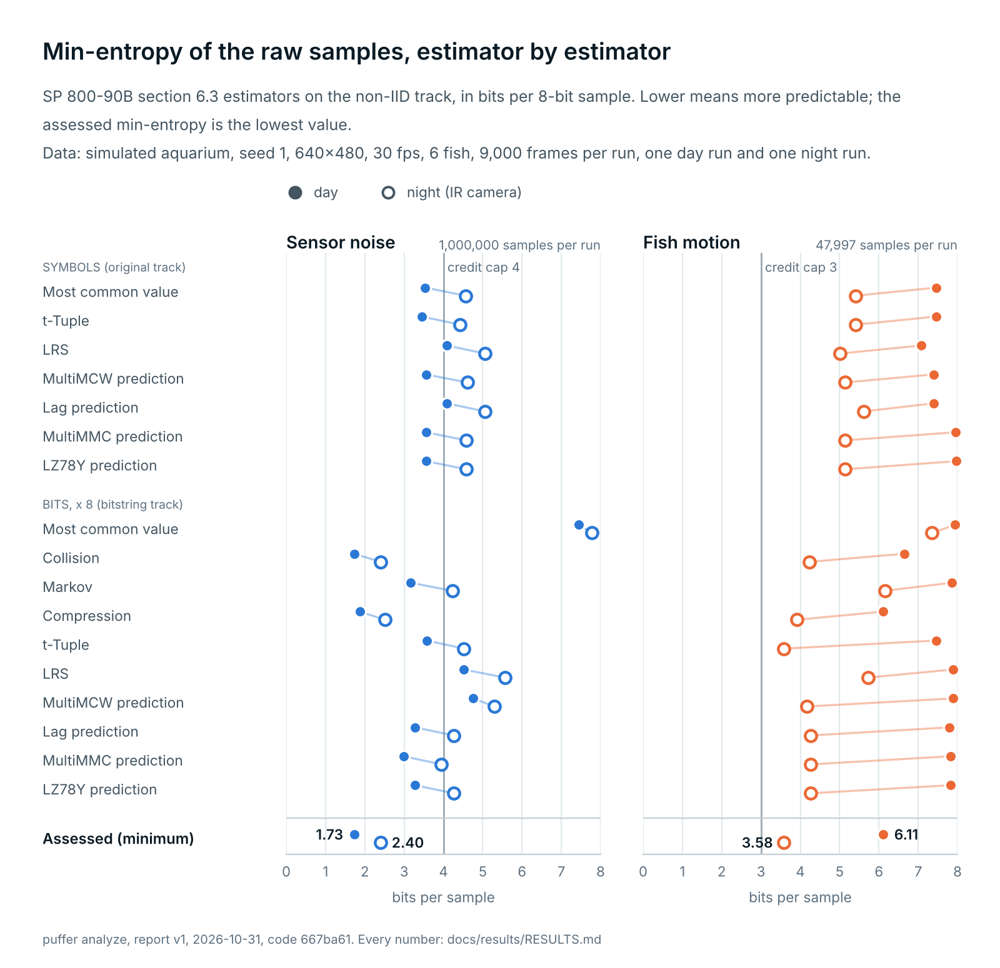
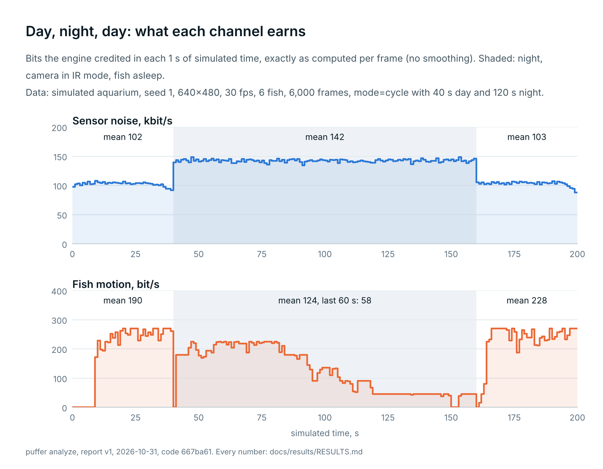
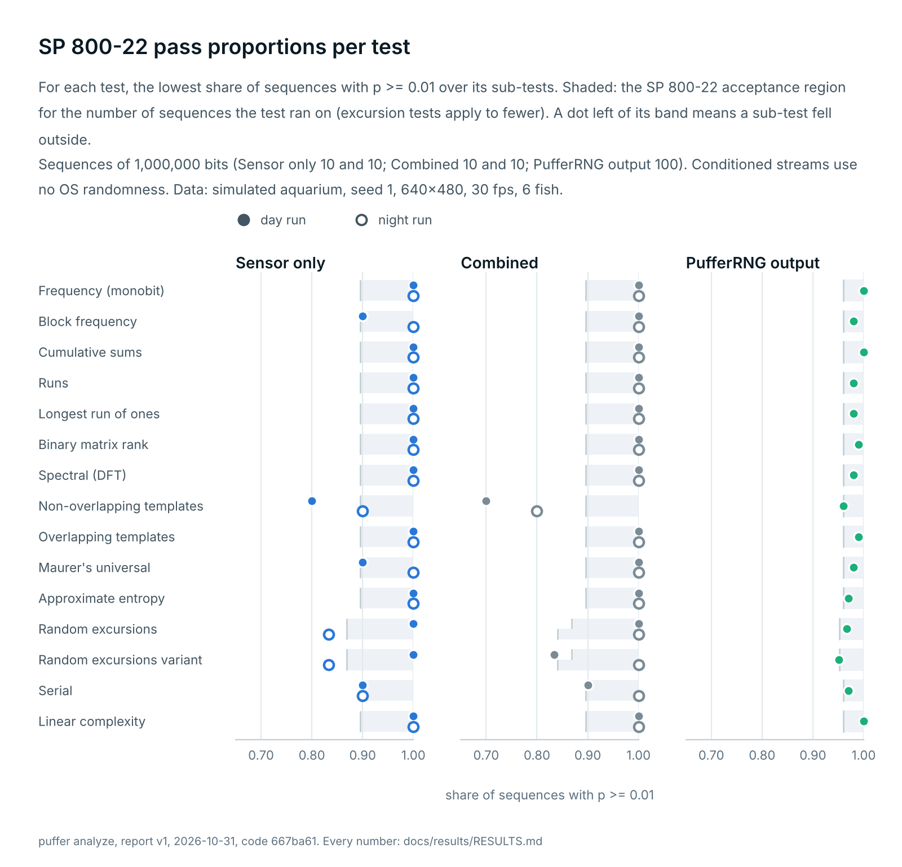
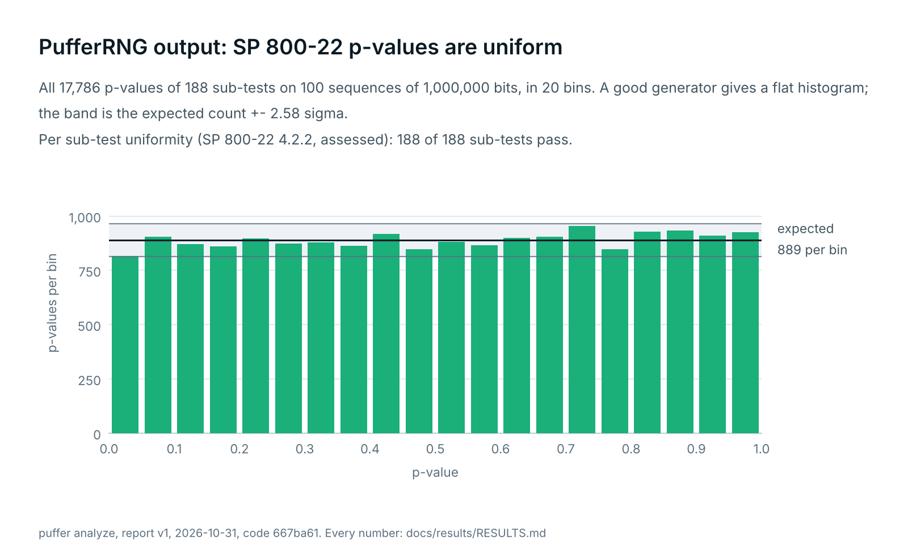
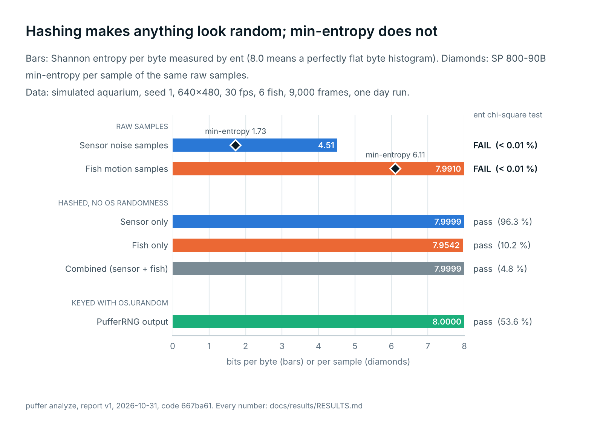
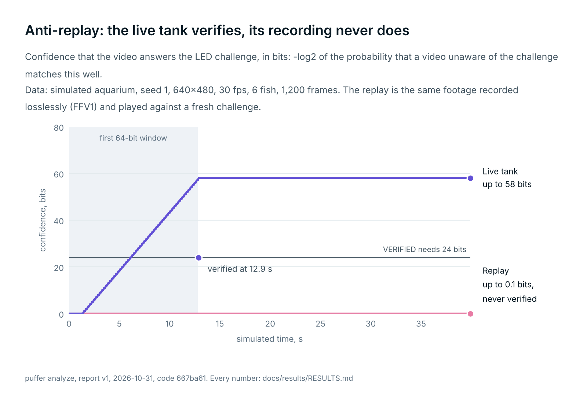

# Results

Statistical analysis of the puffer-cipher entropy channels, produced by `puffer analyze` (`puffer.analysis.report`) on 2026-10-31 from code `667ba61`. Every figure is also in [`results.json`](results.json).

> [!IMPORTANT]
> **All data in this report comes from the simulated aquarium** (`SyntheticAquarium`, seed 1, 640x480 pixels, 30 fps, 6 fish). No real fish and no real camera were involved.
> The simulator draws its sensor noise and fish behaviour from a seeded pseudo-random generator, so to anyone who knows the seed its samples carry no entropy at all. The estimates below show how unpredictable the samples look to the SP 800-90B estimators, which is what the same code would measure on a real camera. They are not evidence that this run produced secret bits.

## Summary

|  | Sensor noise, day | Sensor noise, night | Fish motion, day | Fish motion, night |
| :--- | ---: | ---: | ---: | ---: |
| Min-entropy, SP 800-90B (bits per sample) | 1.729 | 2.404 | 6.110 | 3.583 |
| Samples assessed (SP 800-90B asks for 1,000,000) | 1,000,000 | 1,000,000 | 47,997 | 15,705 |
| Credited by the engine (bit/s, after start-up) | 103,838 | 142,543 | 242.4 | 76.8 |

* **Liveness.** The live tank was VERIFIED after 12.9 s (confidence 58.1 bits at best). A bit-exact replay of the same footage peaked at 0.1 bits against the 24-bit threshold, never verified and earned 0 camera bits.
* **PufferRNG output, SP 800-22:** 100 sequences of 1,000,000 bits, 183 of 188 sub-tests inside the acceptance band (outside: `non_overlapping_template_matching[010001111]`, `non_overlapping_template_matching[111110100]`, `non_overlapping_template_matching[111110110]`, 2 more); a perfect generator leaves 3.6 outside on average. Expected for keyed BLAKE2b and ChaCha20 output, and not evidence of entropy.
* **dieharder** (88 results over 30 tests): 83 PASSED, 5 WEAK, 0 FAILED.
* **Raw samples are not uniform, and should not be.** Raw sensor bytes (day) have 4.51 bits of Shannon entropy per byte and fail ent's chi-square test; only their min-entropy, measured above, says what they are worth.

## 1. Data

Each run is one `EntropyEngine` built by `puffer.runtime.build_engine`, stepped frame by frame; an output listener records every channel output, the credit the engine gave it and the channel's health state. Analysis runs use `liveness=off` and no LED; the liveness runs use the simulated LED and `liveness=required`. Engine settings are the defaults: 4,096 sensor sites, safety factor 0.5, credit caps of 4.0 (sensor) and 3.0 (fish) bits per sample. Simulated time runs at the source frame rate. "Frames/s here" is how fast the engine got through the run during this report, with up to 4 runs in parallel on the machine below: a record of this report, not a benchmark.

| run | source | seed | resolution | frames | simulated time | frames/s here |
| :--- | :--- | :--- | ---: | ---: | ---: | ---: |
| `day` | simulated aquarium | 1 | 640x480 | 9,000 | 300.0 s | 24.1 fps |
| `night` | simulated aquarium | 1 | 640x480 | 9,000 | 300.0 s | 40.6 fps |
| `cycle` | simulated aquarium, 40 s day / 120 s night | 1 | 640x480 | 6,000 | 200.0 s |  |
| `live` | simulated aquarium, LED shows challenge A | 1 | 640x480 | 1,200 | 40.0 s |  |
| `replay` | FFV1 recording of `live`, fresh challenge | 1 | 640x480 | 1,200 | 40.0 s |  |
| `control` | FFV1 recording of `live`, challenge A | 1 | 640x480 | 1,200 | 40.0 s |  |

Machine: Linux x86_64, 4 CPUs; Python 3.13.18, NumPy 2.5.4, SciPy 1.18.1, OpenCV 5.0.0, PyNaCl 1.6.2.

## 2. Raw min-entropy (SP 800-90B)

The samples each channel credits, assessed with all estimators of SP 800-90B section 6.3 on the non-IID track (section 3.1.3, 8 bits per sample). The sensor channel's samples are temporal differences `(I_t - I_t-1) mod 256` of the green channel at fixed random pixel sites; the fish channel's are the low 4 bits of each axis of a confirmed track's Kalman innovation at 1/8-pixel resolution. Values are bits per sample; the bitstring track (each sample written as 8 bits, at most the first 1,000,000 bits) is scaled by 8 to the same unit. The assessed entropy is the smallest number in each column.

Data: day (simulated aquarium, seed 1, 640x480, 30 fps, 6 fish, 9,000 frames); night (simulated aquarium, seed 1, 640x480, 30 fps, 6 fish, 9,000 frames).

| estimator | Sensor noise, day | Sensor noise, night | Fish motion, day | Fish motion, night |
| :--- | ---: | ---: | ---: | ---: |
| Most common value (6.3.1) | 3.537 | 4.559 | 7.462 | 5.408 |
| t-Tuple (6.3.5) | 3.444 | 4.427 | 7.462 | 5.408 |
| LRS (6.3.6) | 4.086 | 5.059 | 7.079 | 5.010 |
| MultiMCW prediction (6.3.7) | 3.559 | 4.606 | 7.392 | 5.132 |
| Lag prediction (6.3.8) | 4.082 | 5.061 | 7.393 | 5.610 |
| MultiMMC prediction (6.3.9) | 3.555 | 4.585 | 7.953 | 5.133 |
| LZ78Y prediction (6.3.10) | 3.565 | 4.588 | 7.961 | 5.133 |
| Most common value (6.3.1) (bits x 8) | 7.451 | 7.773 | 7.938 | 7.355 |
| Collision (6.3.2) (bits x 8) | 1.729 | 2.404 | 6.643 | 4.228 |
| Markov (6.3.3) (bits x 8) | 3.158 | 4.225 | 7.863 | 6.151 |
| Compression (6.3.4) (bits x 8) | 1.874 | 2.508 | 6.110 | 3.917 |
| t-Tuple (6.3.5) (bits x 8) | 3.582 | 4.521 | 7.454 | 3.583 |
| LRS (6.3.6) (bits x 8) | 4.513 | 5.570 | 7.889 | 5.724 |
| MultiMCW prediction (6.3.7) (bits x 8) | 4.763 | 5.289 | 7.893 | 4.162 |
| Lag prediction (6.3.8) (bits x 8) | 3.274 | 4.265 | 7.801 | 4.270 |
| MultiMMC prediction (6.3.9) (bits x 8) | 2.984 | 3.950 | 7.829 | 4.270 |
| LZ78Y prediction (6.3.10) (bits x 8) | 3.274 | 4.265 | 7.829 | 4.270 |
| **H, original track** (min) | 3.444 | 4.427 | 7.079 | 5.010 |
| **H, bitstring track** (min, x 8) | 1.729 | 2.404 | 6.110 | 3.583 |
| **Assessed H** = min of both | **1.729** | **2.404** | **6.110** | **3.583** |
| samples assessed | 1,000,000 | 1,000,000 | 47,997 | 15,705 |
| share of the 1,000,000 SP 800-90B asks for | 100.0 % | 100.0 % | 4.8 % | 1.6 % |
| bits on the bitstring track | 1,000,000 | 1,000,000 | 383,976 | 125,640 |

Sample counts, stated plainly: the sensor channel yields 4,096 samples per frame, so the full 1,000,000 samples come from about 245 consecutive frames. The fish channel yields one sample per confirmed fish per frame; the counts above are everything the runs produced, a small fraction of what the standard asks for, so the fish estimates carry wide confidence bounds (all estimators use 99 % upper bounds, which makes them lower, not higher, on short data).

<picture>
  <source media="(prefers-color-scheme: dark)" srcset="../media/min-entropy-dark.png">
  
</picture>

**Credit versus assessment.** The engine credits `n * min(H_est, cap) * safety_factor`, where `H_est` is a quick rolling estimate (minimum of MCV, Lag and MultiMMC on the last 4,096 samples, original track only). The table compares the credit per sample the engine actually gave with the full assessment above.

| channel | engine H_est, mean | credited per sample | assessed H | credited / assessed |
| :--- | ---: | ---: | ---: | ---: |
| Sensor noise, day | 1.690 | 0.845 | 1.729 | 0.49 |
| Fish motion, day | 5.491 | 1.500 | 6.110 | 0.25 |
| Sensor noise, night | 2.320 | 1.160 | 2.404 | 0.48 |
| Fish motion, night | 3.925 | 1.500 | 3.583 | 0.42 |

Every ratio is at most 1: the engine never credited more per sample than the full assessment supports.

## 3. Credit by day and by night

What the engine credited, from its own per-output credit (not re-computed). "After start-up" starts at the channel's first credited output (the first 1,024 samples must pass the health tests first). The system channel adds 256 bits of `os.urandom` to every pool draw on top of these, whatever the tank does.

|  | Sensor noise, day | Sensor noise, night | Fish motion, day | Fish motion, night |
| :--- | ---: | ---: | ---: | ---: |
| samples per frame | 4,095.5 | 4,095.5 | 5.3 | 1.7 |
| SP 800-90B H (bits per sample) | 1.729 | 2.404 | 6.110 | 3.583 |
| engine H_est, mean (bits per sample) | 1.690 | 2.320 | 5.491 | 3.925 |
| credit cap (bits per sample) | 4.0 | 4.0 | 3.0 | 3.0 |
| credited per sample (bits) | 0.845 | 1.160 | 1.500 | 1.500 |
| credited, whole run (bit/s) | 103,815 | 142,511 | 234.9 | 73.4 |
| credited after start-up (bit/s) | 103,838 | 142,543 | 242.4 | 76.8 |
| first credit after (s) | 0.1 | 0.1 | 9.4 | 13.2 |
| time OK | 100.0 % | 100.0 % | 96.9 % | 87.3 % |
| time DEGRADED | 0.0 % | 0.0 % | 0.0 % | 8.3 % |
| time STARTUP or FAILED | 0.0 % | 0.0 % | 3.1 % | 4.4 % |
| confirmed fish tracks per frame |  |  | 5.70 | 1.84 |

### Day, night, day (simulated aquarium, seed 1, 640x480, 30 fps, 6 fish, 6,000 frames)

The simulator in `mode=cycle`: 40 s of day (the last 8 s dim like dusk), 120 s of night with the camera in IR mode (monochrome, dimmer, noisier: read noise sigma 6.0 instead of 2.0), then day again. The fish sleep at night: fewer confirmed tracks, smaller innovations.

| phase | time | sensor (bit/s) | fish (bit/s) | fish tracks per frame | fish channel OK |
| :--- | ---: | ---: | ---: | ---: | ---: |
| day | 0 to 40 s | 102,374 | 190.5 | 5.44 | 76.6 % |
| night | 40 to 160 s | 142,236 | 123.9 | 2.91 | 97.6 % |
| night, second half | 100 to 160 s | 142,276 | 58.2 | 1.37 | 95.7 % |
| day (again) | 160 to 200 s | 103,093 | 227.5 | 5.36 | 97.5 % |

Fish credit falls from 190.5 bit/s by day to 58.2 bit/s in the second half of the night, as the sleeping fish move less and fewer of them stay tracked (5.4 confirmed tracks per frame by day, 1.4 in the second half of the night); the drop is gradual because the fish settle over tens of seconds. The sensor channel earns 102,374 bit/s by day and 142,236 bit/s at night: its credit rises with the IR mode's higher read noise. The two channels do not interact; each is credited from its own samples. For one second after each switch the fish channel credits nothing: the motion detector rebuilds its background model when the image changes between colour and IR. All of this describes the simulator's camera and fish models; a real NoIR camera and real fish need their own measurement.

<picture>
  <source media="(prefers-color-scheme: dark)" srcset="../media/day-night-cycle-dark.png">
  
</picture>

## 4. Conditioned streams and PufferRNG output (SP 800-22)

Conditioned streams use **no** operating-system randomness (`puffer.entropy.ConditionedStream`, analysis only): a block of raw samples is compressed to 256 bits with unkeyed BLAKE2b once its credited min-entropy reaches 512 bits. Credited min-entropy per sample is the engine's rule applied to the assessment of section 2, `min(H, cap) * 0.5`, so each output bit is backed by at least four bits of assessed min-entropy. The combined stream interleaves both channels frame by frame at their sample-weighted rate. PufferRNG output is the production path (keyed with `os.urandom`), requested 1 MiB per `generate` call during the first run.

| stream | os.urandom | raw samples in | credited H per sample | output bits | sequences x bits | tests run | SP 800-22 |
| :--- | :--- | ---: | ---: | ---: | ---: | ---: | :--- |
| Sensor only, day | no | 36,859,904 | 0.864 | 15,912,448 | 10 x 1,000,000 | 15 of 15 | 3 of 188 sub-tests outside (chance: 2.2, P = 0.38) |
| Fish only, day | no | 47,997 | 1.500 | 35,840 | 1 x 35,840 | 7 of 15 | 153 of 155 p-values >= 0.01 |
| Combined (sensor + fish), day | no | 36,907,901 | 0.865 | 15,960,064 | 10 x 1,000,000 | 15 of 15 | 6 of 188 sub-tests outside (chance: 2.2, P = 0.03) |
| Sensor only, night | no | 36,859,904 | 1.202 | 22,150,400 | 10 x 1,000,000 | 15 of 15 | 2 of 188 sub-tests outside (chance: 2.2, P = 0.65) |
| Fish only, night | no | 15,705 | 1.500 | 11,520 | 1 x 11,520 | 7 of 15 | 155 of 155 p-values >= 0.01 |
| Combined (sensor + fish), night | no | 36,875,609 | 1.202 | 22,159,872 | 10 x 1,000,000 | 15 of 15 | 2 of 188 sub-tests outside (chance: 1.7, P = 0.51) |
| PufferRNG output, day | yes |  |  | 100,000,000 | 100 x 1,000,000 | 15 of 15 | 5 of 188 sub-tests outside (chance: 3.6, P = 0.29) |

Multi-sequence verdicts follow SP 800-22 section 4.2: for every sub-test the proportion of sequences with p >= 0.01 must lie inside `0.99 +- 3 sqrt(0.99 x 0.01 / m)`, and from 55 sequences on the p-values must also be uniform (P >= 0.0001). Even a perfect generator puts some sub-tests outside; the "chance" figure is how many it would on average with that many sequences, so the observed count is judged against it, not against zero; P is the chance of at least the observed count (Poisson approximation; the excursion states of one sequence are correlated, so the true spread is somewhat wider). With few sequences the band is wide and the test is weak; each stream gets as many full sequences as its data provided, up to the configured maximum.

Lowest pass proportion over each test's sub-tests (148 templates, 8 + 18 excursion states, 2 cumulative sums and 2 serial sub-tests). The random excursion tests only apply to sequences whose random walk returns to zero at least 500 times, so they run on fewer sequences, their band is wider, and one unusual sequence moves all of its 8 or 18 states together:

| test | Sensor only, day | Combined (sensor + fish), day | Sensor only, night | Combined (sensor + fish), night | PufferRNG output, day |
| :--- | ---: | ---: | ---: | ---: | ---: |
| Frequency (monobit) | 1.000 | 1.000 | 1.000 | 1.000 | 1.000 |
| Block frequency | 0.900 | 1.000 | 1.000 | 1.000 | 0.980 |
| Cumulative sums | 1.000 | 1.000 | 1.000 | 1.000 | 1.000 |
| Runs | 1.000 | 1.000 | 1.000 | 1.000 | 0.980 |
| Longest run of ones | 1.000 | 1.000 | 1.000 | 1.000 | 0.980 |
| Binary matrix rank | 1.000 | 1.000 | 1.000 | 1.000 | 0.990 |
| Spectral (DFT) | 1.000 | 1.000 | 1.000 | 1.000 | 0.980 |
| Non-overlapping templates | 0.800 (3 flagged) | 0.700 (2 flagged) | 0.900 | 0.800 (2 flagged) | 0.960 (3 flagged) |
| Overlapping templates | 1.000 | 1.000 | 1.000 | 1.000 | 0.990 |
| Maurer's universal | 0.900 | 1.000 | 1.000 | 1.000 | 0.980 |
| Approximate entropy | 1.000 | 1.000 | 1.000 | 1.000 | 0.970 |
| Random excursions | 1.000 | 1.000 | 0.833 (1 flagged) | 1.000 | 0.967 |
| Random excursions variant | 1.000 | 0.833 (4 flagged) | 0.833 (1 flagged) | 1.000 | 0.951 (2 flagged) |
| Serial | 0.900 | 0.900 | 0.900 | 1.000 | 0.970 |
| Linear complexity | 1.000 | 1.000 | 1.000 | 1.000 | 1.000 |
| band lower edge at 10, 100 sequences | 0.896 | 0.896 | 0.896 | 0.896 | 0.960 |

<picture>
  <source media="(prefers-color-scheme: dark)" srcset="../media/sp800-22-proportions-dark.png">
  
</picture>

<picture>
  <source media="(prefers-color-scheme: dark)" srcset="../media/sp800-22-pvalues-dark.png">
  
</picture>

**Fish only, day: 35,840 bits, shorter than one 1,000,000-bit sequence.** Only the tests whose recommended input size fits ran, once each:

| test | result | p-value or reason |
| :--- | :--- | :--- |
| Frequency (monobit) | pass | p = 0.0138 |
| Block frequency | pass | p = 0.7099 |
| Cumulative sums | pass | p = 0.0133 (lowest of 2) |
| Runs | p < 0.01 | p = 0.0009 |
| Longest run of ones | pass | p = 0.1498 |
| Binary matrix rank | skipped | needs n >= 38,912 bits (SP 800-22 2.5.7), got n=35,840 |
| Spectral (DFT) | pass | p = 1.0000 |
| Non-overlapping templates | p < 0.01 | p = 0.0012 (lowest of 148) |
| Overlapping templates | skipped | needs n >= 1,000,000 bits (SP 800-22 2.8.7), got n=35,840 |
| Maurer's universal | skipped | needs n >= 387,840 bits for L >= 6, got n=35840 |
| Approximate entropy | skipped | needs n >= 65,536 bits (SP 800-22 2.12.7: m < log2(n) - 5), got n=35,840 |
| Random excursions | skipped | needs n >= 1,000,000 bits (SP 800-22 2.14.7), got n=35,840 |
| Random excursions variant | skipped | needs n >= 1,000,000 bits (SP 800-22 2.15.7), got n=35,840 |
| Serial | skipped | needs n >= 524,288 bits (SP 800-22 2.11.7: m < log2(n) - 2), got n=35,840 |
| Linear complexity | skipped | needs n >= 1,000,000 bits (SP 800-22 2.10.7), got n=35,840 |

**Fish only, night: 11,520 bits, shorter than one 1,000,000-bit sequence.** Only the tests whose recommended input size fits ran, once each:

| test | result | p-value or reason |
| :--- | :--- | :--- |
| Frequency (monobit) | pass | p = 0.2557 |
| Block frequency | pass | p = 0.4663 |
| Cumulative sums | pass | p = 0.3593 (lowest of 2) |
| Runs | pass | p = 0.1203 |
| Longest run of ones | pass | p = 0.9769 |
| Binary matrix rank | skipped | needs n >= 38,912 bits (SP 800-22 2.5.7), got n=11,520 |
| Spectral (DFT) | pass | p = 0.1238 |
| Non-overlapping templates | pass | p = 0.0106 (lowest of 148) |
| Overlapping templates | skipped | needs n >= 1,000,000 bits (SP 800-22 2.8.7), got n=11,520 |
| Maurer's universal | skipped | needs n >= 387,840 bits for L >= 6, got n=11520 |
| Approximate entropy | skipped | needs n >= 65,536 bits (SP 800-22 2.12.7: m < log2(n) - 5), got n=11,520 |
| Random excursions | skipped | needs n >= 1,000,000 bits (SP 800-22 2.14.7), got n=11,520 |
| Random excursions variant | skipped | needs n >= 1,000,000 bits (SP 800-22 2.15.7), got n=11,520 |
| Serial | skipped | needs n >= 524,288 bits (SP 800-22 2.11.7: m < log2(n) - 2), got n=11,520 |
| Linear complexity | skipped | needs n >= 1,000,000 bits (SP 800-22 2.10.7), got n=11,520 |

## 5. ent: raw samples versus conditioned output

The in-process equivalent of John Walker's `ent` (`puffer.analysis.ent`). A random byte stream has 8 bits per byte, mean 127.5, a chi-square value that a random stream would exceed between 1 % and 99 % of the time, pi within a fraction of a percent and serial correlation near 0.

| stream | bytes | entropy (bits/byte) | chi-square | chi-square exceeded | mean | Monte Carlo pi error | serial correlation |
| :--- | ---: | ---: | ---: | ---: | ---: | ---: | ---: |
| raw sensor samples, day | 36,859,904 | 4.5135 | 508,919,892.4 | < 0.01 % | 117.039 | 2.947 % | +0.00037 |
| raw fish samples, day | 47,997 | 7.9910 | 591.3 | < 0.01 % | 127.301 | 0.357 % | -0.00082 |
| raw sensor samples, night | 36,859,904 | 5.3244 | 242,550,106.3 | < 0.01 % | 122.639 | 3.976 % | +0.00015 |
| raw fish samples, night | 15,705 | 7.6722 | 8,867.1 | < 0.01 % | 122.198 | 2.646 % | +0.02100 |
| Sensor only, day | 1,989,056 | 7.9999 | 216.2 | 96.30 % | 127.495 | 0.002 % | +0.00045 |
| Fish only, day | 4,480 | 7.9542 | 284.1 | 10.16 % | 127.639 | 0.155 % | -0.02265 |
| Combined (sensor + fish), day | 1,995,008 | 7.9999 | 293.8 | 4.78 % | 127.545 | 0.075 % | -0.00019 |
| Sensor only, night | 2,768,800 | 7.9999 | 260.7 | 39.03 % | 127.499 | 0.156 % | +0.00057 |
| Fish only, night | 1,440 | 7.8550 | 280.2 | 13.36 % | 126.825 | 0.798 % | -0.04139 |
| Combined (sensor + fish), night | 2,769,984 | 7.9999 | 285.5 | 9.16 % | 127.483 | 0.057 % | +0.00007 |
| PufferRNG output, day | 12,500,000 | 8.0000 | 252.3 | 53.61 % | 127.532 | 0.019 % | -0.00016 |

Raw samples fail, as they should: sensor differences cluster around 0 (and 255) and fish innovations around small values, so their byte histogram is far from flat. Every hashed stream passes. This is the point of DESIGN.md rule 4: hashing makes any input look random, so these statistics cannot tell good entropy from none. The min-entropy of the raw samples (section 2) is the measurement that matters.

Cross-check with the real `ent` binary on two of the streams:

| stream | entropy (bits/byte) | chi-square | chi-square exceeded |
| :--- | ---: | ---: | ---: |
| day/sensor (raw) | 4.513508 | 508,919,892.38 | < 0.01 % |
| day/pufferrng | 7.999985 | 252.29 | 53.61 % |

<picture>
  <source media="(prefers-color-scheme: dark)" srcset="../media/ent-raw-vs-conditioned-dark.png">
  
</picture>

## 6. Liveness: live tank versus replay

Data: simulated aquarium, seed 1, 640x480, 30 fps, 6 fish, 1,200 frames. The simulated LED shows challenge A (seeded with 1, 0.2 s per Manchester-coded bit) and the live run is recorded, frame for frame, to a lossless FFV1 file (613 MB). The replay feeds that file to a new engine with `liveness=required` and a fresh challenge from `os.urandom`; the verifier is even told where the LED is, the most favourable setup for an attacker. The control replays the same file against challenge A.

| run | video | LED challenge | VERIFIED after | max confidence (bits) | final match ratio | final state | camera credit (bits) |
| :--- | :--- | :--- | :--- | ---: | ---: | :--- | ---: |
| `live` | live simulator | A (seeded) | 12.87 s | 58.1 | 1.000 | VERIFIED | 2,304,492 |
| `replay` | FFV1 replay of `live` | fresh (os.urandom) | never | 0.1 | 0.562 | FAILED | 0 |
| `control` | FFV1 replay of `live` | A (seeded) | 12.87 s | 58.1 | 1.000 | VERIFIED | 2,304,968 |

`confidence_bits = -log2(P[Binomial(n, 1/2) >= matches] x n_lags)` over the last 64 bits; VERIFIED needs at least 24 bits and a match ratio of at least 0.9. The live run can verify no earlier than one full window (12.8 s) after the start, and its first camera credit follows the 5 s health cooldown. The replay's best judged window matched 58 % of the bits (bits the LED detector cannot decode count as misses), well short of the 90 % needed: a recording made before the challenge existed cannot contain it. The control passing shows that the replay fails because the challenge is fresh, not because of the codec or the detector.

<picture>
  <source media="(prefers-color-scheme: dark)" srcset="../media/liveness-replay-dark.png">
  
</picture>

## 7. Fish tracking quality

Every fish observation is credited as entropy and attributed to a named fish, so a swaying plant or a bubble tracked as a fish would make both claims false. `puffer.vision.evaluate.evaluate_tracking` scores the default tracker (motion detector, ByteTrack, re-identification) against the simulator's ground truth: simulated aquarium, seed 1, 640x480, 30 fps, 6 fish, 1,800 frames per mode, the first 150 not scored, Hungarian matching at IoU >= 0.3. Contamination counts observations whose box lies mostly off every real fish.

|  | day | night |
| :--- | ---: | ---: |
| detection precision | 98.4 % | 91.3 % |
| detection recall | 93.8 % | 67.7 % |
| fish-track precision | 97.7 % | 94.7 % |
| fish recall | 94.7 % | 53.7 % |
| observed recall (fed the entropy channel) | 91.8 % | 51.6 % |
| contamination (observations not on a fish) | 0.46 % | 0.83 % |
| track ID switches per minute | 25.1 | 6.5 |
| fish-ID switches per minute | 13.1 | 0.0 |
| identity purity | 99.6 % | n/a |
| identity coverage | 94.3 % | 0.0 % |
| mean centre error (px) | 2.2 | 4.3 |
| ground-truth fish per frame | 6.00 | 6.00 |
| tracker speed during this report (frames/s) | 48 | 107 |

At night the IR image has no colour, so appearance re-identification has little to work with and the sleeping fish move little; `scripts/eval_tracking.py` runs the same evaluation over more seeds and scenarios.

## 8. dieharder

dieharder 3.31.1, raw input from a pipe (`-g 200`), so nothing is ever rewound. The pipe carries PufferRNG output, 1 MiB per `generate` call (one pool draw keyed with fresh `os.urandom` each), while an engine on `synthetic:seed=1,mode=day,realtime=0` keeps absorbing frames in the background, exactly like `puffer random --stream | dieharder -g 200`. Ran these tests, one dieharder process each: `-d 0`, `-d 1`, `-d 2`, `-d 3`, `-d 4`, `-d 5`, `-d 6`, `-d 7`, `-d 8`, `-d 9`, `-d 10`, `-d 11`, `-d 12`, `-d 13`, `-d 15`, `-d 16`, `-d 17`, `-d 100`, `-d 101`, `-d 102`, `-d 200 -n 1`, `-d 200 -n 2`, `-d 200 -n 3`, `-d 200 -n 4`, `-d 200 -n 5`, `-d 200 -n 6`, `-d 200 -n 7`, `-d 200 -n 8`, `-d 200 -n 9`, `-d 200 -n 10`, `-d 200 -n 11`, `-d 200 -n 12`, `-d 201 -n 2`, `-d 201 -n 3`, `-d 201 -n 4`, `-d 201 -n 5`, `-d 202 -n 2`, `-d 202 -n 3`, `-d 202 -n 4`, `-d 202 -n 5`, `-d 204`, `-d 205`, `-d 206`, `-d 207`, `-d 208`, `-d 209`, `-d 203 -n 0`, `-d 203 -n 1`, `-d 203 -n 2`, `-d 203 -n 3`, `-d 203 -n 4`, `-d 203 -n 8`, `-d 203 -n 16`, `-d 203 -n 32`. That is every test and ntuple of `dieharder -a` with two cuts: `diehard_sums` (`-d 14`) is left out because dieharder itself rates it "Do Not Use", and the RGB lagged sum runs lags 0 to 4, 8, 16 and 32 instead of all 33 (lag n reads n + 1 times the data; the full sweep alone takes about half an hour, the whole `-a` battery about 40 minutes on this machine). Time: 12.3 min of a 20 min budget; 50.1 GiB fed in 51,254 calls; the engine processed 20,890 frames meanwhile.

**83 PASSED, 5 WEAK, 0 FAILED** over 88 results. WEAK means a p-value in the outer 0.5 % on either side; with this many results a few are expected from a perfect generator (dieharder's documentation says the same).

| test | ntup | results | PASSED | WEAK | FAILED | lowest p |
| :--- | :--- | ---: | ---: | ---: | ---: | ---: |
| `diehard_birthdays` | 0 | 1 | 1 | 0 | 0 | 0.6438 |
| `diehard_operm5` | 0 | 1 | 1 | 0 | 0 | 0.6837 |
| `diehard_rank_32x32` | 0 | 1 | 1 | 0 | 0 | 0.6120 |
| `diehard_rank_6x8` | 0 | 1 | 1 | 0 | 0 | 0.2878 |
| `diehard_bitstream` | 0 | 1 | 1 | 0 | 0 | 0.8581 |
| `diehard_opso` | 0 | 1 | 1 | 0 | 0 | 0.5342 |
| `diehard_oqso` | 0 | 1 | 1 | 0 | 0 | 0.6505 |
| `diehard_dna` | 0 | 1 | 1 | 0 | 0 | 0.4567 |
| `diehard_count_1s_str` | 0 | 1 | 0 | 1 | 0 | 0.0047 |
| `diehard_count_1s_byt` | 0 | 1 | 1 | 0 | 0 | 0.6295 |
| `diehard_parking_lot` | 0 | 1 | 1 | 0 | 0 | 0.2005 |
| `diehard_2dsphere` | 2 | 1 | 1 | 0 | 0 | 0.7229 |
| `diehard_3dsphere` | 3 | 1 | 1 | 0 | 0 | 0.6610 |
| `diehard_squeeze` | 0 | 1 | 1 | 0 | 0 | 0.2405 |
| `diehard_runs` | 0 | 2 | 2 | 0 | 0 | 0.0367 |
| `diehard_craps` | 0 | 2 | 2 | 0 | 0 | 0.2525 |
| `marsaglia_tsang_gcd` | 0 | 2 | 2 | 0 | 0 | 0.1864 |
| `sts_monobit` | 1 | 1 | 1 | 0 | 0 | 0.9246 |
| `sts_runs` | 2 | 1 | 1 | 0 | 0 | 0.9814 |
| `sts_serial` | 1, 2, 3, 4, 5, 6, 7, 8, 9, 10, 11, 12, 13, 14, 15, 16 | 30 | 29 | 1 | 0 | 0.0352 |
| `rgb_bitdist` | 1, 2, 3, 4, 5, 6, 7, 8, 9, 10, 11, 12 | 12 | 10 | 2 | 0 | 0.0156 |
| `rgb_minimum_distance` | 2, 3, 4, 5 | 4 | 4 | 0 | 0 | 0.0362 |
| `rgb_permutations` | 2, 3, 4, 5 | 4 | 4 | 0 | 0 | 0.3111 |
| `rgb_kstest_test` | 0 | 1 | 1 | 0 | 0 | 0.5452 |
| `dab_bytedistrib` | 0 | 1 | 1 | 0 | 0 | 0.4691 |
| `dab_dct` | 256 | 1 | 1 | 0 | 0 | 0.3907 |
| `dab_filltree` | 32 | 2 | 2 | 0 | 0 | 0.4266 |
| `dab_filltree2` | 0, 1 | 2 | 2 | 0 | 0 | 0.3793 |
| `dab_monobit2` | 12 | 1 | 1 | 0 | 0 | 0.2453 |
| `rgb_lagged_sum` | 0, 1, 2, 3, 4, 8, 16, 32 | 8 | 7 | 1 | 0 | 0.0700 |

## 9. What this does not show

* **Simulated data.** The tank, its fish, its light and its camera noise are models driven by a seeded generator. The numbers say how the pipeline behaves on that model; a real aquarium and camera need their own run of this report (`puffer analyze --source camera:0` or a lossless recording).
* **Entropy is only measured on raw samples.** SP 800-22, ent and dieharder on hashed or keyed output pass whatever the input; they check the conditioning and the generator, not the fish.
* **Short fish data.** SP 800-90B wants 1,000,000 samples; the fish channel produced a few percent of that, so its estimate is a rough lower bound, and the fish-only conditioned stream is too short for most SP 800-22 tests.
* **Not exactly reproducible.** The engine draws its sensor sample sites from `os.urandom` (as in production) and PufferRNG is keyed with `os.urandom`, so a re-run with the same seed gives close but not identical figures.
* **Liveness proves freshness, not authenticity.** An attacker who watches the LED live and composites it into fake video passes (DESIGN.md section 5). Even then outputs stay as strong as `os.urandom`.

## 10. Reproduce

```sh
puffer analyze --frames 9000 --seed 1 --dieharder
```

This run took 19.7 min: collection 376 s, SP 800-90B 26 s, streams and SP 800-22 43 s, dieharder 740 s, with 4 worker processes.
